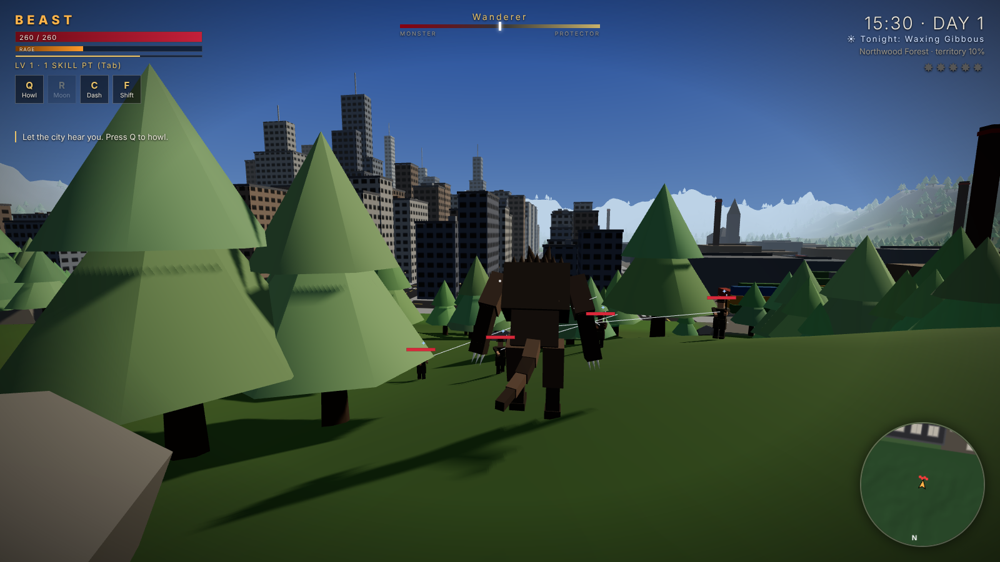
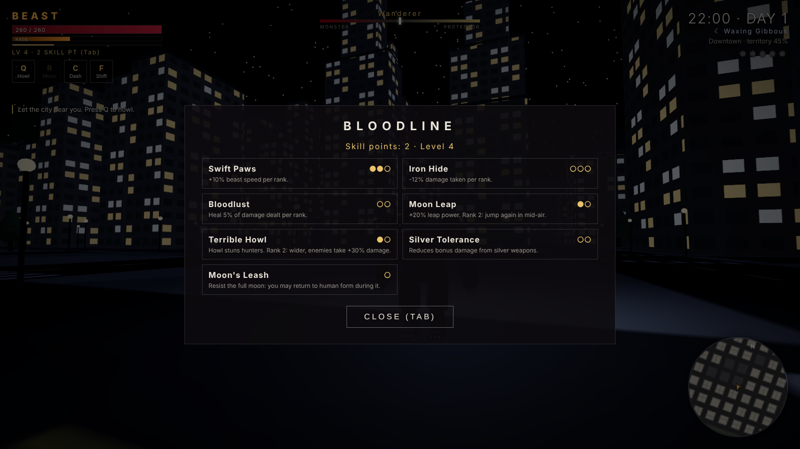

<p align="center"></p>

<h1 align="center">LYCAN</h1>
<p align="center"><b>The Ultimate Werewolf Simulator</b></p>

<p align="center">
  <a href="https://github.com/NyteRyzer/lycangame/actions/workflows/build.yml"></a>
  
</p>


A third-person open-world werewolf action game. You can change between human and beast whenever you want, and the full moon forces the change. You roam **Greyhaven**: downtown towers, suburbs, an industrial district, a lake, a forest and mountains. Every choice you make pushes you toward becoming the city's protector or its greatest threat.

The main design goal: **moving around as the werewolf should be fun on its own, even when you're not on a mission.**

## Screenshots

| | |
| --- | --- |
|  <br> **Climb anything.** Run into a wall to scale it, then pull up onto the roof. |  <br> **Own the skyline.** Rooftops are your highway at dusk. |
|  <br> **Drop to all fours** and build up to 30 m/s down the avenues. |  <br> **Charged leaps** launch you wherever you're looking. |
|  <br> **Transform at will.** Bones crack, a roar, a shockwave. |  <br> **The full moon** forces the change every third night. |
|  <br> **Vampires** prey on civilians at night. Save them, or don't. |  <br> **Silver Dawn hunters** answer your heat with silver rifles. |
|  <br> **The Ancient Ruins**, where you learn the Old Magic. |  <br> **The Blackfang Alpha** and its pack wait in the peaks. |
|  <br> **Greyhaven**: about 1.4 km square, with territory control in every district. |  <br> **Bloodline skills**: speed, armour, double jump, howl and more. |

<p align="center"></p>

## Download / build

Builds are produced for **Linux, Windows and macOS**.

| Platform | Output | Command |
| --- | --- | --- |
| Linux | `LYCAN-x.y.z.AppImage`, `.tar.gz` | `npm run dist:linux` |
| Windows | `LYCAN Setup x.y.z.exe` (installer), portable `.zip` | `npm run dist:win` |
| macOS | `.dmg`, `.zip` (Intel + Apple Silicon) | `npm run dist:mac` |

Packages land in `dist/`.

**CI builds:** `.github/workflows/build.yml` runs on every push and uploads three artifacts: **LYCAN-Linux** (AppImage + tar.gz), **LYCAN-Windows** (installer + portable zip) and **LYCAN-macOS** (Intel + Apple Silicon zips, packaged on Linux). Download them from the run's **Artifacts** section.

Pushing a tag like `v0.1.0` attaches everything to a GitHub Release. Tag builds (or a manual *Run workflow*) also try to build a native macOS `.dmg`. That job needs a GitHub macOS runner; if none is available it is cancelled without failing the build.

Build notes:

- From Linux, `npm run dist:all` builds the Linux packages, the Windows portable `.zip` and the macOS `.zip`. The Windows installer (`.exe`) needs Windows or wine, and the macOS `.dmg` needs a Mac. CI builds the installer on every push, and the `.dmg` on release tags.
- Builds are **unsigned**:
  - **macOS:** right-click the app and choose *Open* the first time, or run `xattr -cr LYCAN.app`.
  - **Windows:** SmartScreen may ask you to click *More info → Run anyway*.
- To sign builds, set the usual electron-builder `CSC_LINK` / `CSC_KEY_PASSWORD` secrets in CI.

## Run from source

```bash
npm install
npm start          # desktop window (Electron)
npm run serve      # or play in a browser at http://localhost:8080
npm run smoke      # headless gameplay smoke test (needs playwright)
npm run screenshots  # regenerate the README screenshots in docs/screenshots
```

## Controls

| Input | Action |
| --- | --- |
| WASD / left stick | Move |
| Mouse / right stick | Look |
| **F** | Transform (human ⇄ beast) |
| **Shift** | Sprint. As the beast you drop to all fours and pick up speed. |
| **Space** | Jump. As the beast, **hold and release** for a charged leap in the direction you're looking. |
| Run into a wall | **Climb** (beast). Space while on a wall = wall-jump. You climb over the top edge automatically. |
| LMB | Claw combo (3rd hit is a finisher). In the air: **pounce** on the nearest target. |
| RMB | Heavy smash. High in the air: **ground slam** (shockwave scales with fall height). |
| C / Alt | Dash (brief invulnerability) |
| Q | Howl: civilians flee (or cheer, if you're their guardian), hunters are stunned, +25% damage |
| R | Moonfire: a ranged blast of lunar flame. You learn it at the Ancient Ruins. |
| E | Interact / feed on the fallen (heals; feeding on innocents costs morality) |
| Y / N | Accept / decline a contract offer |
| Tab | Skill tree · **M** Map · **Esc** Pause · **F11** Fullscreen |

Gamepads with the standard (Xbox) layout are supported.

## What's in this build

**Transformation.** You can transform at any time. It's a 1.3 s sequence: the human body swells, the beast bursts out, a roar plays, and the emergence sends out a shockwave. Each form plays differently:

- **Human:** 100 HP, fragile (takes fall damage), slow, but invisible to the hunters while your heat is low.
- **Beast:** 260 HP, fast regeneration, 30 m/s four-legged sprint, charged leaps, climbing, slams and claws. Civilians who see you raise your heat.

Every third night is a **full moon**. When it rises you're forced into beast form and can't change back until dawn, unless you learn *Moon's Leash*. You also get +30% damage, rage keeps building, and the sky turns brighter.

**Traversal (the core of the game).**

- Sprint speed builds with momentum, and sharp turns at speed cost some of it.
- The camera widens its FOV and pulls back as you speed up. Speed lines and rushing wind add to the feel.
- Charged leaps launch you along your camera's aim.
- You can climb any building, scuttle sideways along a wall, wall-jump, and mantle over the top. Rooftops have obstacles to vault.
- Big drops end in a ground-slam shockwave.

**The world.** Greyhaven is about 1.4 km square, with no loading screens:

- Downtown grid with towers up to 120 m.
- Suburbs, an industrial yard with stacked containers, and a lakeside with docks and cabins.
- Northwood forest (~4,000 trees) and the Ashen Peaks.
- Landmarks:
  - **Ancient Ruins** with the Moon Shrine
  - **Hunters' Lodge**
  - **St. Corvin Cathedral** (vampire nest)
  - **Blackfang Den**

There's a full day/night cycle (12 real minutes per day) with a 3-night moon cycle.

**Who lives there:**

- **Civilians** go about their day, panic at the beast, and report sightings, which raises your heat.
- **Hunters** of the Order of the Silver Dawn use silver rifles. Their aim gets worse the faster you move.
- **Vampires** feed on civilians at night, blink-lunge, and turn to ash when killed.
- The **Blackfang** pack's rival werewolves and their **Alpha** boss.

**Morality and consequences:**

- **Morality** runs from −100 (*The Beast of Greyhaven*) to +100 (*Guardian of Greyhaven*).
- **Heat** (0–5) controls how many hunters come after you.
- You have standing with four factions, and **territory control** in each of six districts.
- A guardian gets a truce with the hunters and civilians who cheer instead of scream. A monster gets more heat, more hunters, and Vampire Court contracts.

**Missions:**

- **Story thread:** transform → run → climb → leap → howl → learn the Old Magic at the shrine → choose your path → defeat the Blackfang Alpha. Then you get an **ending** based on your morality: Guardian, Beast or Lone Alpha. Beating the Alpha also gives you two **packmates** who follow you and fight with you.
- **Dynamic events:**
  - Vampire attacks: save the victims, or let them die.
  - Hunter patrols.
  - Rival pack incursions.
- **Contracts:**
  - The Vampire Court's *Blood Tithe* (villain).
  - The Mayor's *Break the Lodge* (hero).
  - The Order's *Uneasy Truce* (purge the cathedral).

**Progression.** You earn XP, levels and skill points. There are 7 skills: Swift Paws, Iron Hide, Bloodlust, Moon Leap (double jump), Terrible Howl, Silver Tolerance and Moon's Leash.

**Saving.** The game autosaves every 30 s and when you quit. *Continue* is on the title screen.

All visuals are procedural, made from primitives and generated textures, and all audio is synthesized at runtime: howls, roars, gunshots, wind and a heartbeat. There are no asset files to license.

## Project layout

```
src/            game source (bundled by esbuild → app/game.js)
  main.js       renderer, loop, menus, save/load
  world.js      Greyhaven: terrain, districts, colliders, sky, day/moon cycle
  player.js     forms, transformation, traversal, combat, skills
  characters.js procedural human + werewolf rigs and animation
  npcs.js       civilians, hunters, vampires, werewolves, AI, projectiles
  story.js      morality, heat, factions, territory, objectives, events, contracts
  camera.js     third-person camera (speed FOV, collision, shake)
  hud.js        HUD, minimap, overlay markers, menus
  fx.js audio.js input.js util.js geo.js
app/            index.html, style.css (+ bundled game.js)
electron/       desktop shell (main + preload)
build/          app icon for packaging
scripts/        build, smoke test, README screenshots
docs/           screenshots
```

## Roadmap

The next steps from the game bible:

- Skinned and animated character models.
- Demons, witches and spirits.
- Witch magic trees.
- Interiors.
- Police vehicles and chases.
- Voiced story missions.
- Territory perks.
- Multiple werewolf forms (e.g. a lighter "lupine" scout form vs. the hulking "crinos").
